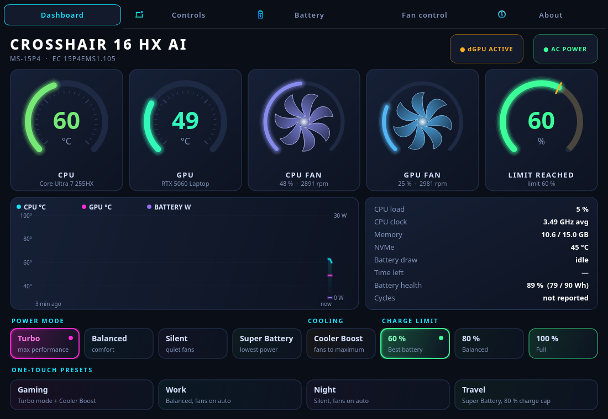

##  Open-source control centre for MSI laptops 

Goal: **work on every MSI laptop that msi-ec supports** (gaming series mostly). **KDE Plasma is the primary desktop**; GNOME, XFCE and others work through the plain Qt tray app and the session D-Bus API (a GNOME Shell integration is welcome - see CONTRIBUTING.md). Light on resources: ~0 CPU in the tray, a few % of one core while the window is open.

**Your laptop not listed or something looks off?** Run `/usr/libexec/mcontrolcenter/mcontrolcenter-doctor report` and open a *Hardware report* issue




**Install (Debian/Ubuntu/Kali tested; Fedora, Arch, openSUSE paths written, untested):**

```bash
git clone https://github.com/p34t1k/MControlCenter && cd MControlCenter && ./install.sh
```

The installer builds the app, installs it with its root helper and tray autostart, and sets up the **msi-ec kernel driver** through DKMS.
It also installs `mcontrolcenter-doctor` and a boot-time service that **repairs the driver after kernel updates**: if the new kernel has no headers or
no msi-ec build, it installs the headers (and the header *meta* package so future kernels bring theirs), rebuilds via DKMS, loads the module and
persists it. The app shows a one-click "Fix it now" banner instead of an error dialog if anything is still wrong. `./install.sh --uninstall` removes it.

- **Adapts to your MSI laptop** - what the Dashboard shows comes from the capabilities msi-ec reports (shift modes, fan modes, cooler boost, GPU sensor, second fan, charge limit). Missing features simply disappear.
- **Dashboard** - telemetry panels with LED-style segmented meters and peak-hold marks, rotating fan glyphs with inertia, battery meter with charge-limit notch, 3-minute interactive graph (hover for a read-out), mode strip, one-touch presets (Gaming / Work / Night / Travel). One accent colour follows the active mode; Cooler Boost shows a hazard strip.
- **Every page redesigned** in the same language: Controls (switches, auto-profile, GPU boot mode), Battery (draggable charge limit), Fans (drag-to-edit stepped fan curve with a live "now" marker), About.
- **Keyboard lighting (Mystic Light)**: 24-zone per-key-row editor, HSV picker, hardware effects (breathing / cycle / wave), presets, brightness, and *follow the laptop* (colour by power mode, red flash on overheat, pulse on low battery, off while locked). Works on MSI laptops whose keyboard shows up as USB `1462:16xx` MysticLight; confirmed on the 24-zone `1462:1603`. Never writes the controller's flash. Scriptable: `SetKeyboardColor`, `KeyboardOff`, `KeyboardRestore` on the D-Bus API.
- **Settings page**: start with your session, CPU thermal alerts (85/90/95 °C for 10 s), **auto Turbo + Cooler Boost while a game runs** (Feral GameMode, restores your previous mode afterwards), telemetry export to CSV. Launching the app again raises the window.
- **Report my laptop in one click**: About → *Report a problem / add my laptop* opens a Hardware-report issue with your report already filled in.
- **Discrete GPU boot mode** (NVIDIA hybrid laptops): keeps the dGPU driverless so it sleeps in D3cold (best battery, quietest fans), applied at next boot and reversible; shown only where it is safe. Not a hardware MUX (that is a BIOS setting).
- **Session D-Bus API** `io.github.dmitry_s93.MControlCenter` at `/Control`: `State` (JSON), `SetMode turbo|balanced|silent|eco`, `SetCoolerBoost`, `SetChargeLimit`, `ShowWindow`.
- **KDE integration** - two-way sync with the power-profiles-daemon slider, plus `plasma/local.battery-msi`: the Power & Battery popup with the MSI controls built in.
- Developed on an MSI Crosshair 16 HX AI (MS-15P4, EC 15P4EMS1.105), msi-ec 0.13, Kali + Plasma 6.7. **Other MSI models should work but are untested - please open an issue with your model and what the Dashboard shows.**
- Bundled fonts: Rajdhani and IBM Plex Mono (SIL OFL, see `resources/fonts`).

Dev screenshots: `MCC_SHOT=/tmp/x QT_QPA_PLATFORM=xcb xvfb-run -a ./mcontrolcenter` (note: it applies the saved mode to the EC).

---
# MControlCenter

MControlCenter is a Free and Open Source GNU/Linux application that allows you to change the settings of MSI laptops.


## Features

 - CPU and GPU temperature display
 - Fan speed display
 - Switch between modes (Since version 0.2):
   - High Performance
   - Balanced
   - Silent
   - Super Battery
 - Automatic mode switching (charger status/system power profile)
 - Change the maximum battery level limit
 - Advanced Fan Speed Control (Since version 0.4)
 - Change other settings such as keyboard backlight mode, USB Power Share, etc.

## TODO

- Saving multiple fan speed profiles

## Supported devices

With version 0.5.0 the app uses the msi-ec driver that comes with the linux kernel (you'll need to reinstall the driver), so device support depends on whether the kernel driver supports your device or not.

[**List of tested devices by msi-ec**](https://github.com/BeardOverflow/msi-ec/discussions/277)

If your device is not on the list, follow the steps on the `msi-ec` github page and open an issue there to add support for your device.

## Installation

### Pre-Installation

- Check the output of `cat /sys/devices/platform/msi-ec/shift_mode` in your terminal, if it says `No such file or directory` it means that you need to install or reinstall (uninstall first then install) the [msi-ec driver](https://github.com/BeardOverflow/msi-ec?tab=readme-ov-file#installation). or the application will open **but will have limited functionality!**

- If you're not installing from the packages, You'll need to install `libqt6widgets6` or its equivalent on your distribution (`qt6-base` for example). **the application will fail to open without it!** 

- To get temperature and fan curve support, you'll need to install `ec_sys`, which comes installed on most distributions, or `acpi_sys` (fedora) with `write_support=1`. the app can still work with only `msi-ec` installed.

### Installation from packages
<details open>
   <summary><b>Ubuntu/Mint/openSUSE (No Debian)</b></summary>

1. Download the correct package for your distribution from the [releases page](https://github.com/dmitry-s93/MControlCenter/releases/)
2. Double click to open it in the software manager (ex. Discover or GNOME software)
3. Install

</details>

<details>
   <summary><b>Arch Linux (AUR)</b></summary>

An officially maintained package is available under the name [mcontrolcenter-bin](https://aur.archlinux.org/packages/mcontrolcenter-bin). You can install it using any AUR helper (yay/paru):
`yay mcontrolcenter-bin`

Or you can use the generic installer in the [releases page](https://github.com/dmitry-s93/MControlCenter/releases/)

</details>

<details> 
   <summary><b>Fedora</b></summary>
   
An official [copr repo](https://copr.fedorainfracloud.org/coprs/teackot/msi/) can be used

Open your terminal, and run these commands:

1. `sudo dnf copr enable teackot/msi`
2. `sudo dnf install mcontrolcenter`

However, if you didn't follow the above method (built from source or used the generic installer), some extra steps are needed because fedora doesn't come with `ec_sys` module by default:

1. Open a terminal, then install dkms and make:
   
   `sudo dnf install kernel-devel dkms make`

2. Clone the repo:

   `git clone https://github.com/saidsay-so/acpi_ec.git`

3. Change the directory to the cloned repo:

   `cd acpi_ec/`

4. Run the install script as sudo:

   `sudo ./install.sh`

5. Reboot

</details>

<details> 
   <summary><b>Unsupported distributions</b></summary>
No need to try the generic installer, it won't work.

1. Debian: for some reason, they did something weird with `ec_sys` and related functions don't work.
2. Nixos: the app is packaged in the repos, but i don't maintain the package, so dont report bugs.
3. All immutable distributions: that means SteamOS, Bazzite, Fedora Silver blue, and others. the necessary drivers can't be installed.

</details>


Current packages are built using [OBS](https://build.opensuse.org/package/show/home:Mutchiko/mcontrolcenter)

### If your distribution is not listed, try the generic installer:

1. Download MControlCenter-x.x.x.tar.gz from the [releases page](https://github.com/dmitry-s93/MControlCenter/releases/)
2. Unpack the archive with the program
3. Open a terminal in the unpacked directory
4. Run the script `sudo ./install`
5. (Optional) `sudo ./uninstall` to uninstall

**Note:** In some cases, building from source can be a good option too, steps for it can be found further down.

## Extra tweaks
### Laptops with dedicated GPUs
For laptops with a dedicated **Nvidia** graphics card, the power limits won't react to performance mode changes.
To fix this, you need to be using the Nvidia proprietary driver.

Enable and start the `nvidia-powerd` service:
1. `sudo systemctl enable --now nvidia-powerd`
2. Reboot.

Laptops with **AMD** dGPUs (usually AMD Advantage models) don't need any steps, as power limits and smartshift functionality work correctly with each performance mode.

### Laptops with RGB keyboards
Try using [OpenRGB](https://openrgb.org/), and make sure you're using the latest version if your distribution ships old versions.

Regular laptops with only 1 color can be controlled directly by the app. However, RGB keyboards are wired over USB, thats why openRGB is needed.

### MUX switching

For laptops with a dGPU **AND** a mux switch, there is a workaround for switching modes:
Install [supergfxctl](https://gitlab.com/asus-linux/supergfxctl) and couple it with a widget like [supergfxctl-plasmoid](https://gitlab.com/Jhyub/supergfxctl-plasmoid) for KDE, or [supergfxctl-gex](https://extensions.gnome.org/extension/5344/supergfxctl-gex/) for GNOME.

## Building from source

After installing the main package (`qt6-base` or `libqt6widgets6`), you'll need to install other packages to build the app.

For ubuntru/Linux mint:
`qt6-base-dev` and/or `qt6-tools-dev` also `build-essential`

For Arch `qt6-tools` And for fedora `qt6-qttools`

After you install the packages:

Make sure the app is completely closed if it was installed before (check if there is a system tray icon and close it).

Download the source code and extract the zip file.

Open the `scripts` folder.

Open a terminal inside the folder, then run these scripts in order:

1. `build`
2. `create installer`

If things went well, you should see a compressed file,

4. Extract it.
5. Open a terminal inside the new folder
6. Run the **UNINSTALL** script as *sudo*, it might fail if you don't have MCC installed. thats fine.
7. Run the **INSTALL** script as *sudo*, the last line should be a confirmation that the install was successful.
8. Check your apps, McontrolCenter should be there.

If the installation was successful but the app fails to run, open a terminal and type `mcontrolcenter`, copy the output and open an issue (**IF** there isn't one already).

## Launch MControlCenter on session startup

To restore settings after a reboot, add MControlCenter to startup, in many desktop environements, this is available in the settings under an "Autostart" page.

Else, you can execute this command in the terminal:

`cp /usr/share/applications/mcontrolcenter.desktop ~/.config/autostart/mcontrolcenter.desktop`

## Localization

You can help translate the MControlCenter app into your native language

1. Copy `/src/i18n/MControlCenter_en.ts` to `src/i18n/MControlCenter_xx.ts` where xx is language code into which the translation is being made.
2. Open `MControlCenter_xx.ts` in text editor and change `language="en_US"` to your language code.
3. Translate strings into your language directly in a text editor or use the QT Linguist app or Lokalize.
4. Translate `GenericName` in app shortcut `resources/mcontrolcenter.desktop`. To do this, add the line `GenericName[xx]=translated generic name`.
5. Open a pull request on github with a screenshot of the UI using the new language.
